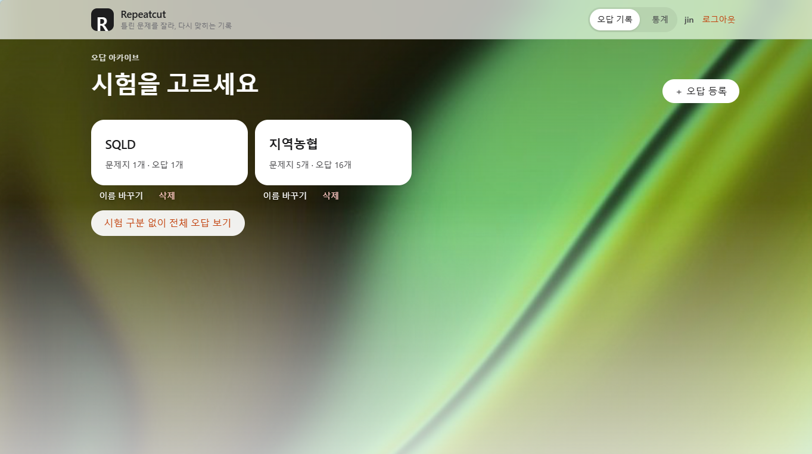
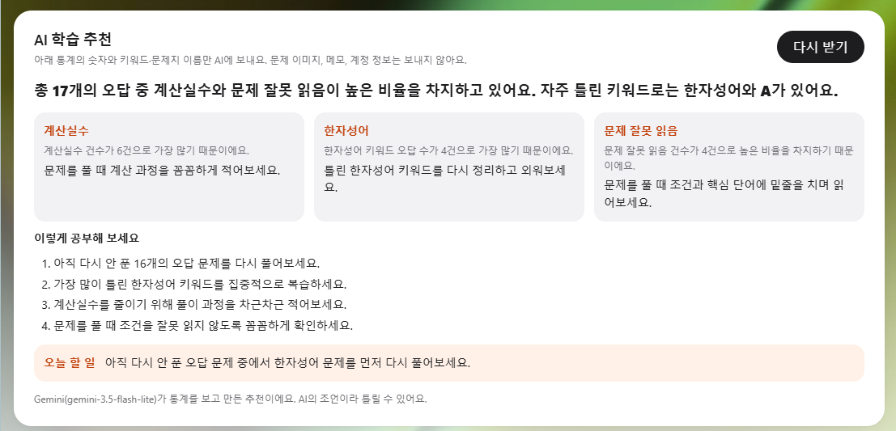
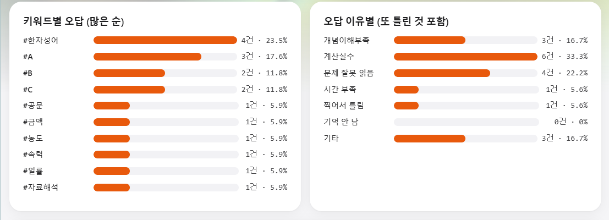
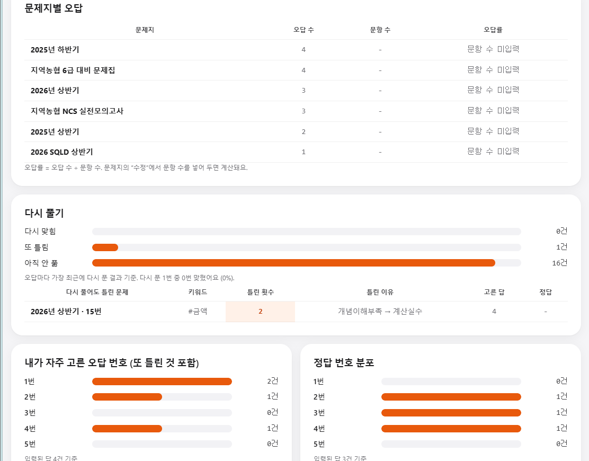

# RepeatCut

**틀린 문제를 잘라 기록하고, 반복 오답과 틀린 이유를 분석해 학습 방법까지 추천하는 오답 기록 서비스**

시험·자격증(지역농협, SQLD 등) 기출 오답을 문제 이미지와 함께 저장하고, 시험 → 유형 → 회차 순서로 찾아보며, 키워드·오답 이유·문제지별 통계와 Gemini 학습 추천으로 약점을 확인하는 웹 서비스입니다.
이전 버전(v1)의 README는 [docs/README-v1.md](docs/README-v1.md)에 보관했습니다.

## 화면

| 시험 선택 | AI 학습 추천 |
|---|---|
|  |  |

| 키워드·이유별 통계 | 다시 풀기와 오답 번호 분포 |
|---|---|
|  |  |

> 화면 속 데이터는 예시입니다. 업로드한 문제 이미지는 저장소에 포함하지 않았습니다.

## v2 변경점

- 이메일 로그인과 회원별 데이터 분리 (비밀번호·토큰은 해시만 저장)
- DB 7개 테이블 구조로 정리 (`users`, `sessions`, `exams`, `papers`, `keywords`, `mistakes`, `attempts`)
- 시험 선택 진입: 시험 → 유형 → 연도별 회차(검색) → 오답 목록, 시험 이름 수정·삭제
- 같은 문제 중복 등록 방지: 이미 등록한 문제는 "이번에 틀린 이유와 고른 답"만 `attempts`에 누적
- 오답 상세에서 이미지 교체, 페이지·답은 선택 입력
- Gemini 학습 추천 (실패해도 규칙 기반 추천으로 대체)
- Apple 스타일 디자인과 그래픽 배경 (파일 한 줄 삭제로 롤백)

## 주요 기능

| 기능 | 설명 |
|---|---|
| 오답 등록 | 문제 사진에서 필요한 영역만 드래그해 저장, 문제지·키워드·오답 이유 선택 |
| 중복 방지 | 같은 문제지 + 같은 문제 번호면 새 오답을 만들지 않고 다시 틀린 기록으로 누적 |
| 탐색 | 시험 이름 → 유형 → 회차 → 오답 목록, 키워드 검색 |
| 통계 | 키워드별·오답 이유별·문제지별 오답, 다시 풀어도 틀린 문제, 고른 답·정답 번호 분포 |
| AI 학습 추천 | 통계의 숫자와 이름만 Gemini에 전송, 버튼을 누를 때만 호출 |
| 보안 | PBKDF2-SHA256 비밀번호, 토큰 SHA-256 해시(7일 만료), 모든 조회에 주인 조건 |

## 기술 스택

- **프론트엔드:** React 18, Vite, Recharts
- **백엔드:** FastAPI, SQLite (`PRAGMA user_version` 기반 번호 있는 구조 변경)
- **AI:** Gemini API
- **테스트:** pytest

## 실행 방법

자세한 순서는 [RUN.md](RUN.md)를 참고하세요. (Windows PowerShell 기준, 터미널 2개)

```powershell
pip install -r requirements.txt
pip install pytest httpx
npm install

# 터미널 1: 백엔드
cd backend
uvicorn main:app --reload --port 8000

# 터미널 2: 프론트엔드 (프로젝트 루트에서)
npm run dev      # http://localhost:5173
```

헬스체크: http://127.0.0.1:8000/api/health

## Gemini 설정 (선택)

키가 없어도 실행되며, 이 경우 규칙 기반 추천이 표시됩니다.

| 환경변수 | 기본값 | 설명 |
|---|---|---|
| `REPEATCUT_GEMINI_API_KEY` | (없음) | Gemini API 키 |
| `REPEATCUT_GEMINI_MODEL` | `gemini-3.8-flash` | 학습 추천에 쓸 모델 이름 |
| `REPEATCUT_GEMINI_TIMEOUT` | `20` | 응답 대기 시간(초) |

API 키는 `.env`나 환경변수로만 설정하고 저장소에 올리지 않습니다. (`.env`는 `.gitignore`에 포함)

## 프로젝트 구조

```
backend/
  main.py                  API 라우터
  repeatcut/
    repository.py          모든 SQL
    database.py            테이블과 구조 변경(migration)
    auth.py                비밀번호·토큰
    advice.py              Gemini 학습 추천과 규칙 기반 대체
    image_storage.py       이미지 저장 (로컬 / S3 호환)
    rules.py, settings.py, bootstrap.py, seed.py
  tests/                   pytest (34개)
src/
  App.jsx
  components/              ExamBrowser, MistakeLibrary, RegisterMistake, Stats, PaperPicker ...
  lib/                     api, auth, errors, paperTitle
  theme-apple.css          Apple 스타일 (롤백 가능)
  theme-hero.css           그래픽 배경 (롤백 가능)
docs/                      발표자료와 화면 이미지
```

## DB 설계

| 테이블 | 뜻 | 키 |
|---|---|---|
| `users` | 회원 | PK `id`, UK `email` |
| `sessions` | 로그인 상태 | PK `id`, FK `user_id`, UK `token_hash` |
| `exams` | 시험 종류 (예: SQLD) | PK `id`, UK `name` (대소문자 무시) |
| `papers` | 문제지 | PK `id`, FK `user_id`, `exam_id`, UK (`user_id`, `exam_id`, `year`, `exam_type`, `round`, `title`) |
| `keywords` | 핵심 키워드 | PK `id`, UK `name` (대소문자 무시) |
| `mistakes` | 오답 | PK `id`, FK `paper_id`, `keyword_id`, UK `image_no` |
| `attempts` | 다시 푼 기록 | PK `id`, FK `mistake_id` (오답 삭제 시 함께 삭제) |

- 주인 정보는 `papers.user_id` 한 곳에만 두고, 오답의 주인은 문제지 기준으로 판단합니다.
- 같은 문제의 기준은 "같은 문제지 + 같은 문제 번호"입니다. (이미지 인식 아님)
- `mistakes.page`가 0이면 페이지 미입력입니다.

## REST API

가입·로그인을 제외한 모든 API는 `Authorization: Bearer <토큰>`이 필요합니다.

| 자원 | 주소 | 기능 |
|---|---|---|
| 회원 | `POST /api/auth/register`, `login`, `logout` · `GET /api/auth/me` | 가입, 로그인, 로그아웃, 내 정보 |
| 시험 | `GET /api/exams` · `PUT`, `DELETE /api/exams/{id}` | 목록, 이름 수정, 삭제 |
| 문제지 | `GET`, `POST /api/papers` · `PUT`, `DELETE /api/papers/{id}` | 목록, 추가, 수정, 삭제 |
| 오답 | `GET`, `POST /api/mistakes` · `PUT`, `DELETE /api/mistakes/{id}` | 목록, 등록, 수정(이미지 교체 포함), 삭제 |
| 중복 확인 | `GET /api/mistakes/lookup` | 이미 등록한 문제 여부 |
| 다시 푼 기록 | `GET`, `POST /api/mistakes/{id}/attempts` | 맞음·틀림 기록 |
| 통계 | `GET /api/stats` | 키워드·이유·문제지·반복 오답 집계 |
| AI 추천 | `POST /api/stats/advice` | 통계 기반 학습 추천 |

응답 코드: `401` 토큰 없음·만료, `404` 남의 데이터 요청, `409` 같은 문제·문제지 중복.

## 테스트

```powershell
pytest backend/tests -v
```

임시 DB를 사용하므로 실제 `data/app.db`는 건드리지 않습니다. (34개 통과)

## 디자인 롤백

`src/main.jsx`에서 아래 import를 지우면 이전 모양으로 돌아갑니다.

```js
import './theme-apple.css'   // Apple 스타일
import './theme-hero.css'    // 그래픽 배경
```

## 발표자료

- [포트폴리오용 6장 (PDF)](docs/RepeatCut_portfolio.pdf) · [PPTX](docs/RepeatCut_portfolio.pptx)

## 개선 예정

- 로그인 시도 횟수 제한, 비밀번호 재설정
- 오답 하나에 키워드 여러 개
- OCR·이미지 유사도로 같은 문제 찾기
- 배포: S3 호환 저장소와 외부 DB(PostgreSQL)로 전환
